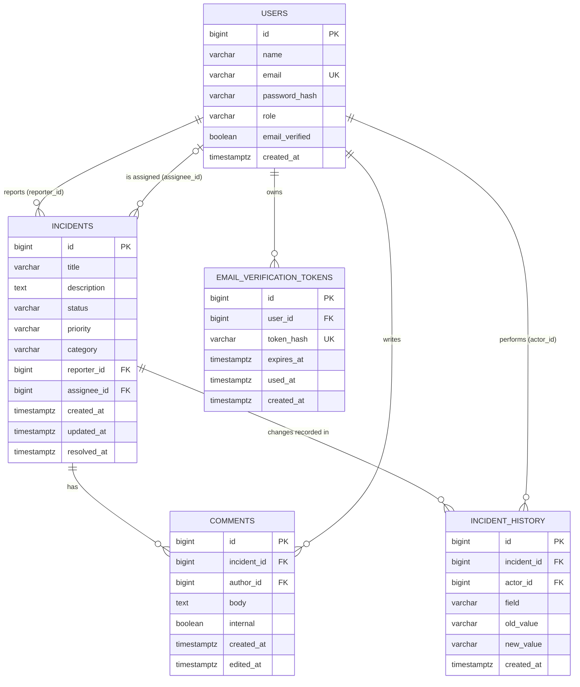

# Incident Tracker — Project Overview

A learning project built step by step: a web application to **register, assign, track and resolve incidents** for a development or support team.

> Status snapshot: November 2026. The functional product (phases 0 to 5) is complete and the quality phase (phase 6) is under way.

## Contents

1. [Purpose](#1-purpose)
2. [Structure](#2-structure)
3. [Entities and relationships](#3-entities-and-relationships)
4. [Learning objectives by stage](#4-learning-objectives-by-stage)
5. [What has been done so far](#5-what-has-been-done-so-far)
6. [What is left to do](#6-what-is-left-to-do)

---

## 1. Purpose

### The product

Incident Tracker centralizes incident management in one place:

- Any registered user can **report** a problem.
- Agents **assign** it to an owner, move it through a **status workflow** and discuss it in **comments**, including internal notes that the reporter does not see.
- Every change is kept in a **history**, shown together with the comments in a timeline.
- Agents and administrators consult **statistics**: workload, trends and resolution times.

### The roles

| Role | Who they are | What they do |
|------|--------------|--------------|
| `USER` | Whoever reports problems | Creates incidents, follows and comments on their own, reopens their resolved ones |
| `AGENT` | Member of the development or support team | Sees all incidents, changes status and priority, assigns, writes internal notes, sees statistics |
| `ADMIN` | An agent who also administers the system | Everything an agent does, plus managing roles and moderating comments |

Registration is **open** so anyone can try the application, with **email verification**. Everybody starts as `USER`, and an administrator promotes the people who join the team.

### The goal behind the product

The project is also a **portfolio and learning vehicle**. It is built the way a professional team would work: one branch and one pull request per task, automated checks on every change, security considered from the start, and decisions that can be explained and defended.

---

## 2. Structure

### Technology stack

| Layer | Technology |
|-------|------------|
| Backend | Java 21, Spring Boot 4, Spring Web, Spring Data JPA, Spring Security (OAuth2 resource server, JWT with HS256), Bean Validation, Lombok, Spring Mail |
| Database | PostgreSQL 16, Flyway migrations |
| Frontend | Vue 3 (Composition API), TypeScript, Vite, Pinia, Vue Router, pnpm |
| Quality | JUnit 5, Mockito, Testcontainers · Vitest, Vue Test Utils · ESLint, Oxlint, Prettier |
| Tooling | Docker Compose (PostgreSQL and Mailpit), GitHub Actions, Dependabot |

### Repository layout

```
incident-tracker/
├── backend/                         Spring Boot REST API
│   ├── src/main/java/com/jose/backend/
│   │   ├── auth/                    Login, registration, email verification, JWT
│   │   ├── comment/                 Incident comments, internal notes
│   │   ├── common/                  Error handling, pagination
│   │   ├── config/                  Security and JWT configuration
│   │   ├── health/                  Health check
│   │   ├── history/                 Change history (written by an event listener)
│   │   ├── incident/                Incidents, workflow, filters
│   │   ├── stats/                   Statistics queries
│   │   └── user/                    Users, roles, current user
│   ├── src/main/resources/
│   │   ├── application.properties
│   │   └── db/migration/            V1 to V5 Flyway scripts
│   └── src/test/                    Unit and integration tests
├── frontend/                        Vue 3 single-page application
│   └── src/
│       ├── api/                     HTTP client and one module per API area
│       ├── components/              Reusable components (badges, charts, timeline...)
│       ├── router/                  Routes and guards
│       ├── stores/                  Pinia authentication store
│       ├── styles/
│       ├── utils/                   Pure helpers (workflow rules, charts, timeline)
│       └── views/                   Login, registration, incidents, statistics
├── docs/                            Project documentation
├── .github/
│   ├── workflows/ci.yml             Build and test on every pull request
│   ├── ISSUE_TEMPLATE/              Bug report and feature request forms
│   ├── pull_request_template.md
│   └── dependabot.yml
├── docker-compose.yml               PostgreSQL and Mailpit for development
├── .env.example                     Variables the application needs
├── .editorconfig  .gitattributes  .gitignore
├── LICENSE                          MIT
└── README.md
```

### API at a glance

| Area | Endpoints |
|------|-----------|
| Health | `GET /api/health` |
| Authentication | `POST /api/auth/login` · `POST /api/auth/register` · `POST /api/auth/verify-email` · `POST /api/auth/resend-verification` · `GET /api/auth/me` |
| Users | `GET /api/users` (admin) · `GET /api/users/assignable` (staff) · `PATCH /api/users/{id}/role` (admin) |
| Incidents | `POST /api/incidents` · `GET /api/incidents` (filters, sorting, pagination) · `GET /api/incidents/{id}` · `PUT /api/incidents/{id}` · `PATCH /api/incidents/{id}/status` · `PATCH /api/incidents/{id}/assignee` |
| History | `GET /api/incidents/{id}/history` |
| Comments | `GET` and `POST /api/incidents/{id}/comments` · `PUT` and `DELETE /api/incidents/{id}/comments/{commentId}` |
| Statistics (staff) | `GET /api/stats/summary` · `GET /api/stats/trend` · `GET /api/stats/resolution-time` |

### Frontend routes

`/login` · `/register` · `/verify-email` · `/incidents` · `/incidents/new` · `/incidents/:id` · `/incidents/:id/edit` · `/stats` (staff only)

### Key design decisions

- **Stateless API**: JWT in the `Authorization` header, no sessions and no cookies, so no CSRF.
- **Roles are read from the database on every request**, not from the token, so a role change or a deleted account takes effect immediately.
- **Visibility rules live in the backend.** A user asking for somebody else's incident gets `404`, as if it did not exist. The UI only hides what the backend would reject.
- **History through events**: `IncidentService` publishes an `IncidentChanged` event and a listener in the `history` package stores it in the same transaction. The incident package does not depend on the history package.
- **Verification emails are sent after the transaction commits**, and only a hash of the token is stored.
- **Statistics are aggregated in the database**, in UTC.
- **No charting library**: CSS bars and an SVG line chart, with a data table for accessibility.
- **Tests use a throwaway PostgreSQL** started by Testcontainers.

### Working conventions

- One branch per task: `feat/…`, `fix/…`, `chore/…`, `ci/…`, `docs/…`, `test/…`.
- Commits and pull request titles follow Conventional Commits.
- Every pull request uses the template, passes the `backend` and `frontend` checks and is merged with **squash and merge** into `main`.
- All project documentation is written in English.

---

## 3. Entities and relationships

### Diagram



### The entities

| Entity | Table | What it represents |
|--------|-------|--------------------|
| `User` | `users` | A person with an account. The table is plural because `user` is reserved in PostgreSQL |
| `Incident` | `incidents` | A reported problem, with a status, a priority, a reporter and an optional assignee |
| `Comment` | `comments` | A message on an incident. It can be an internal note, visible only to staff |
| `IncidentHistory` | `incident_history` | One recorded change of an incident: what changed, from what, to what and who did it |
| `EmailVerificationToken` | `email_verification_tokens` | A single-use, expiring token to confirm an email address. Only its SHA-256 hash is stored |

### The relationships

| Relationship | Meaning | On delete |
|--------------|---------|-----------|
| `users` 1 — N `incidents` (reporter) | Every incident has exactly one reporter | Not allowed: a user with incidents cannot be deleted |
| `users` 0..1 — N `incidents` (assignee) | An incident may have an owner, who must be an agent or an administrator | Not allowed |
| `incidents` 1 — N `comments` | A thread per incident | Comments are deleted with the incident |
| `users` 1 — N `comments` (author) | Who wrote it | Not allowed |
| `incidents` 1 — N `incident_history` | The audit trail of an incident | History is deleted with the incident |
| `users` 1 — N `incident_history` (actor) | Who made the change | Not allowed |
| `users` 1 — N `email_verification_tokens` | A user may have several tokens, only the latest is valid | Tokens are deleted with the user |

### Enumerations

They are stored as strings with `CHECK` constraints, so adding a value is a one-line migration.

| Enumeration | Values |
|-------------|--------|
| `Role` | `USER`, `AGENT`, `ADMIN` |
| `IncidentStatus` | `OPEN`, `IN_PROGRESS`, `IN_REVIEW`, `RESOLVED`, `CLOSED` |
| `IncidentPriority` | `LOW`, `MEDIUM`, `HIGH`, `CRITICAL` |
| `ChangedField` (history) | `CREATED`, `STATUS`, `PRIORITY`, `ASSIGNEE`, `TITLE`, `DESCRIPTION`, `CATEGORY` |

### Status workflow

| From | To |
|------|----|
| `OPEN` | `IN_PROGRESS` |
| `IN_PROGRESS` | `IN_REVIEW`, `OPEN` |
| `IN_REVIEW` | `RESOLVED`, `IN_PROGRESS` |
| `RESOLVED` | `CLOSED`, `OPEN` (reopen) |
| `CLOSED` | `OPEN` (reopen) |

Any other transition returns `409`. `resolved_at` is set when an incident is resolved and cleared when it is reopened. A reporter can only reopen their own resolved incidents.

### Permissions

| Action | USER | AGENT | ADMIN |
|--------|:----:|:-----:|:-----:|
| Create an incident | ✅ | ✅ | ✅ |
| See incidents | own only | all | all |
| Edit title, description and category | own, while open | all | all |
| Change the priority | ❌ | ✅ | ✅ |
| Change the status | reopen own resolved | ✅ | ✅ |
| Assign an incident | ❌ | ✅ | ✅ |
| Comment | on visible incidents | ✅ | ✅ |
| Write or see internal notes | ❌ | ✅ | ✅ |
| Edit a comment | own | own | own |
| Delete a comment | own | own | any |
| See statistics | ❌ | ✅ | ✅ |
| List users and change roles | ❌ | ❌ | ✅ (not their own role) |

### Migrations

| Version | Content |
|---------|---------|
| `V1__init` | Users, incidents, comments and history, with constraints and indexes |
| `V2__email_verification` | `users.email_verified` and the verification tokens table |
| `V3__backfill_incident_history` | A "created" entry for incidents that existed before the history |
| `V4__comment_internal_and_edited` | `comments.internal` and `comments.edited_at` |
| `V5__stats_indexes` | Indexes on `created_at` and `resolved_at` |

---

## 4. Learning objectives by stage

For each stage: what you practice, and a question to check that you can explain it without looking.

### Stage 0 — Repository, workflow and security basics

**Objectives**

- Work with branches, pull requests and squash merges, and write Conventional Commits.
- Configure the repository: `.gitignore`, `.editorconfig`, `.gitattributes`, license and templates.
- Set up continuous integration with GitHub Actions and protect `main` with required checks.
- Run PostgreSQL and a fake mail server with Docker Compose.
- Reduce supply-chain risk: pnpm with a release quarantine and blocked install scripts, Dependabot with a cooldown, least-privilege workflow permissions.
- Keep a personal project isolated from a work environment (a separate WSL distribution, Git identity and Maven settings).

**Self-check**

- Why does squash merge make `git branch -d` complain, and why is that safe?
- What does `minimumReleaseAge` protect you from, and what does it not?

### Stage 1 — Relational modeling and persistence

**Objectives**

- Design tables, keys, constraints and indexes.
- Evolve a schema with versioned Flyway migrations, and never edit an applied one.
- Map tables to JPA entities with lazy relationships.
- Understand why `ddl-auto=validate` is the right companion of Flyway.

**Self-check**

- Why are enums stored as strings with a `CHECK` constraint?
- What happens if you modify `V1__init.sql` after it has been applied?

### Stage 2 — Authentication and authorization

**Objectives**

- Hash passwords with BCrypt and understand its 72-byte limit.
- Issue and validate JWTs with Spring Security as an OAuth2 resource server.
- Authorize by role with `@PreAuthorize`, and read roles from the database instead of the token.
- Build open registration with email verification: random single-use tokens stored as hashes, expiry, resend cooldown, and responses that do not reveal which emails exist.
- Send email after the transaction commits, with a development mail server.
- On the frontend: a Pinia auth store, route guards, an HTTP client that reacts to `401`, and avoiding open redirects.
- Understand the trade-offs of keeping the token in `sessionStorage`.

**Self-check**

- Why does login answer the same way for an unknown email and a wrong password?
- What is lost when roles come from the token, and what is the cost of reading them from the database?

### Stage 3 — Designing a REST API and a state machine

**Objectives**

- Design endpoints, DTOs and validation; handle errors consistently with `ProblemDetail`.
- Model a workflow as an explicit state machine, with the rules in one testable place.
- Enforce visibility by role, answering `404` instead of `403` to avoid leaking existence.
- Build dynamic filters with JPA Specifications, escape search text and whitelist sort fields.
- Paginate, and avoid the N+1 query problem with entity graphs.
- On the frontend: filters stored in the URL, data loading with protection against out-of-order responses, and rendering user text safely.

**Self-check**

- Why is the sort field restricted to a closed list?
- What could go wrong if the UI were the only place that enforced the workflow?

### Stage 4 — Domain events and audit trails

**Objectives**

- Decouple modules with Spring events, and choose between a plain listener (same transaction) and an after-commit listener.
- Record an audit trail atomically with the change it describes.
- Merge two sources of data into a single chronological timeline.
- Handle partial failures in the UI: each block loads and fails on its own.

**Self-check**

- Why is the history written inside the transaction, while the verification email is sent after it?
- What would be missed if someone modified incidents outside `IncidentService`?

### Stage 5 — Aggregation and data visualization

**Objectives**

- Aggregate in the database with JPQL, native queries and projections.
- Handle time zones deliberately (UTC days) and fill empty days with zeros.
- Draw charts without a library: scaling, SVG paths and axes.
- Make charts accessible: not relying on color alone, text descriptions and data tables.

**Self-check**

- Why is it better to count in SQL than to load every incident into Java?
- What are the pros and cons of using a charting library here?

### Stage 6 — Quality, documentation and readiness

**Objectives**

- Test against a real database with Testcontainers, sharing one container across the whole run.
- Prove that all migrations work on an empty database.
- Document the API with OpenAPI.
- Write end-to-end tests for the main flows and run them in CI.
- Write contribution guidelines.

**Self-check**

- Why is a real PostgreSQL better than an in-memory database for these tests?
- Which flows deserve an end-to-end test, and which are better covered by unit tests?

### Stage 7 — Hardening and deployment

**Objectives**

- Rate-limit registration, login and resend endpoints.
- Manage secrets outside the repository and rotate them.
- Choose between a reverse proxy and CORS for production, and serve over HTTPS.
- Configure a real SMTP provider.
- Package the application with Docker and deploy it.

**Self-check**

- Which settings must differ between development and production, and where does each one come from?
- What are the risks of an open registration on a public demo, and which defenses cover them?

---

## 5. What has been done so far

### Phase 0 — Repository foundations ✅

- Repository configuration: `.gitignore` (root, backend, frontend), `.editorconfig`, `.gitattributes`, `.env.example`, MIT license, `docs/` folder and recommended VS Code extensions.
- Spring Boot backend and Vue 3 + TypeScript frontend initialized, with pnpm and its security settings (7-day release quarantine, build scripts blocked unless allowed).
- `docker-compose.yml` with PostgreSQL 16, later extended with Mailpit (pinned version, ports bound to localhost).
- GitHub Actions workflow with a `backend` and a `frontend` job; branch protection on `main` with required checks.
- Pull request template, issue forms (bug report and feature request) and Dependabot configuration (Maven, pnpm, GitHub Actions, Docker Compose), including an `ignore` rule for `@types/node` major versions.
- Development environment: a dedicated Ubuntu distribution on WSL with JDK 21, Docker Engine, Node through nvm, pnpm, and a personal Git identity separate from the work environment.

### Phase 1 — Database and domain ✅

- Migration `V1` with users, incidents, comments and history; enums, JPA entities and Spring Data repositories.
- Health check endpoint that queries the database, shown by the frontend, which validated the whole chain from browser to PostgreSQL.

### Phase 2 — Authentication ✅

- Configuration from environment variables with a validated JWT secret, and an initial administrator created at startup from `ADMIN_EMAIL` and `ADMIN_PASSWORD`.
- Login with BCrypt and JWT; stateless, role-based security.
- Open registration with email verification (migration `V2`), resend with a cooldown, and Mailpit for development.
- Users API: list, assignable users and role changes; roles read from the database on every request.
- Frontend: login, registration and verification views, auth store, interceptor, route guards and session expiry handling.

### Phase 3 — Incident management ✅

- Incident API: create, list with filters, sorting and pagination, detail, edit, status changes with workflow rules and assignment; visibility by role.
- Frontend: incident list with filters stored in the URL, detail view with workflow buttons and assignee selector, and a create and edit form.

### Phase 4 — History and comments ✅

- Change history recorded through events, with a backfill migration (`V3`) for existing incidents.
- Comments with internal notes, editing and deletion (migration `V4`).
- Frontend: a timeline in the incident detail that merges changes and comments, with a comment form, editing and confirmed deletion.

### Phase 5 — Statistics ✅

- Statistics API: summary, daily trend and resolution time, with indexes (migration `V5`), restricted to staff.
- Frontend dashboard with cards, bar lists and an SVG line chart, with a period selector and independent loading of each block.
- Resilience: the session is kept when the server is unavailable, with a banner and a "Retry" button, and a retry button in the incident list.

### Phase 6 — Quality ✅

- Integration tests moved to a throwaway PostgreSQL started with Testcontainers, with a shared container, a `test` profile, a migration test and a simpler CI job.

### Problems solved along the way

| Problem | Lesson |
|---------|--------|
| Enterprise Managed User account could not create pull requests | A managed account is tied to its company; use the personal account for personal projects |
| Maven could not download dependencies (TLS handshake errors) | Distinguish network problems from build problems; a corporate network can interfere |
| `release version 21 not supported` | The compiler uses the JDK it finds first; isolate toolchains per environment |
| Port 8080 already in use | WSL distributions share the network of the host |
| `Failed to resolve component` with no build error | A missing import in a template is not a compile error; strict checks and tests that mount the real view catch it |
| CORS errors in development | The Vite proxy keeps a single origin; a stale `VITE_API_URL` bypassed it |
| Closing a Dependabot pull request by mistake | `Close with comment` sits next to `Comment`; Dependabot commands such as `@dependabot reopen` can recover it |
| Logged out when the backend stopped | Only a rejected token should end a session, not any network error |
| Spring Boot 4 package changes | Test and auto-configuration imports moved; read the compiler error rather than guessing |

---

## 6. What is left to do

### Finish Phase 6

- [x] **Verify and merge Testcontainers** (the checklist in the previous step).
- [x] **`feat/openapi-docs`**: interactive API documentation with springdoc (Swagger UI), descriptions and the bearer authentication scheme.
- [x] **`test/e2e-playwright`**: end-to-end tests of registration and verification, login, creating and resolving an incident, and the statistics page, plus a CI job.
- [x] **`docs/contributing`**: `CONTRIBUTING.md`, and a README review: the roadmap checkboxes, and the setup section, which still mentions running the whole stack with Docker Compose although the compose file only starts PostgreSQL and Mailpit.
- [x] Simplify the statistics tests to assert exact totals now that they start from an empty database.

### Before opening the demo to the public

- [x] **Rate limiting** on registration, login and resend verification.
- [ ] **Production configuration**: a real SMTP provider, `APP_BASE_URL`, a random `JWT_SECRET`, a strong administrator password and secrets kept out of the repository.
- [ ] **Reverse proxy or CORS** for the production domains, and HTTPS.
- [ ] **Dockerfiles** for the backend and the frontend, and a deployment target.
- [ ] Clean up expired verification tokens with a scheduled task.
- [x] Enable GitHub secret scanning and push protection, and pin GitHub Actions to commit hashes.
- [ ] Decide whether to move the token to an `HttpOnly` cookie, which also requires CSRF protection.

### Planned features

- [ ] **User administration screen**: list users and change roles from the interface (the API already exists).
- [ ] Tooltips on the trend chart, and "Retry" buttons on the detail and statistics views.
- [ ] A partial-update `PATCH` for incidents, so `PUT` can stay a full replacement.

### Backlog (Phase 7)

- Attachments on incidents.
- Email or webhook notifications.
- Custom labels and categories.
- SLAs and due-date alerts.
- `@user` mentions in comments.
- CSV export.
- Dark mode and internationalization (ES/EN).

### Pending decisions

- The open Dependabot pull request for Vitest 5: read its release notes and merge or close it.
- Whether to adopt a charting library if richer charts are needed.
- Whether to cache the statistics if the data grows.
